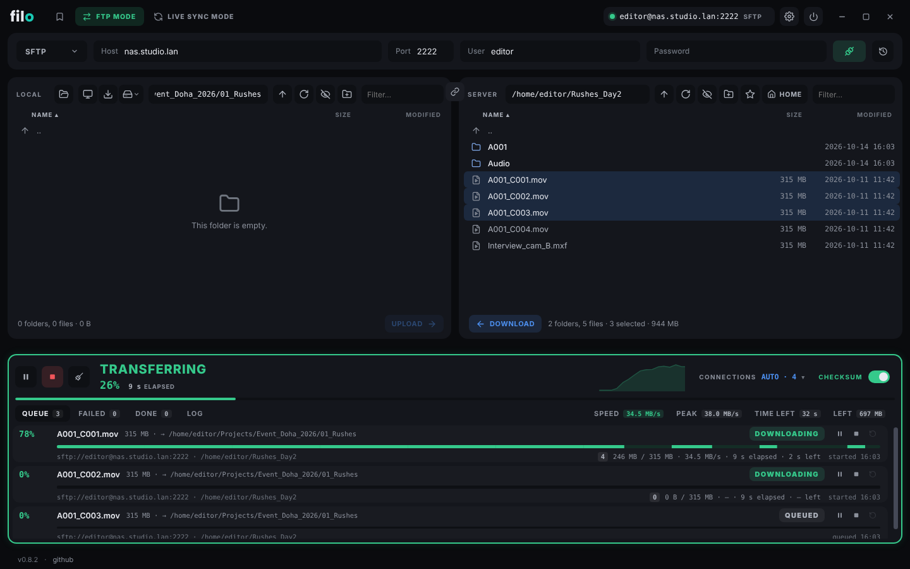
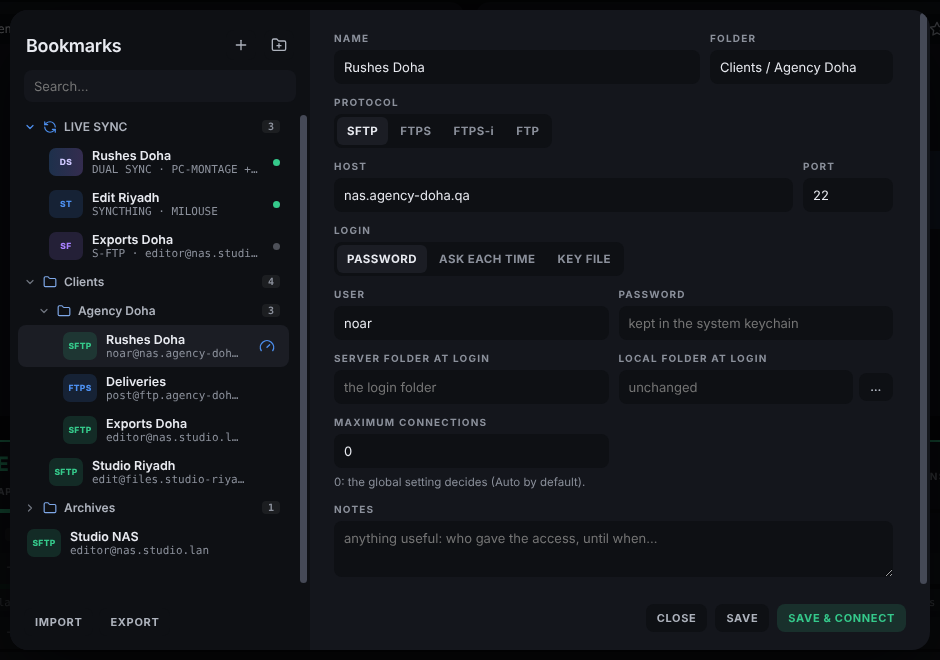
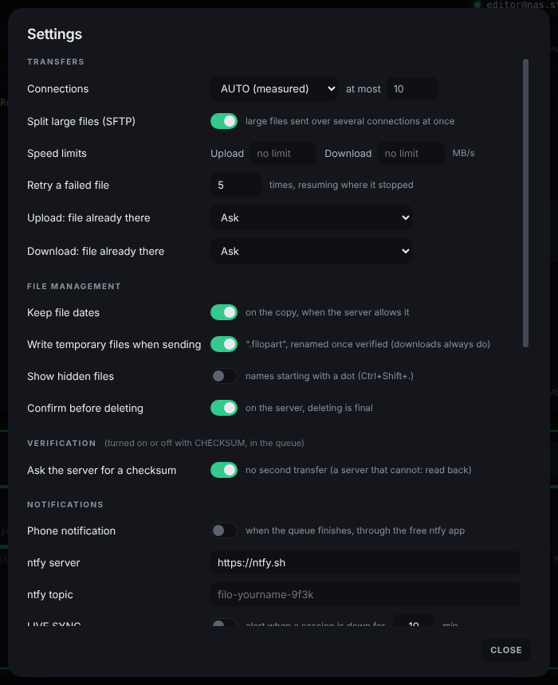
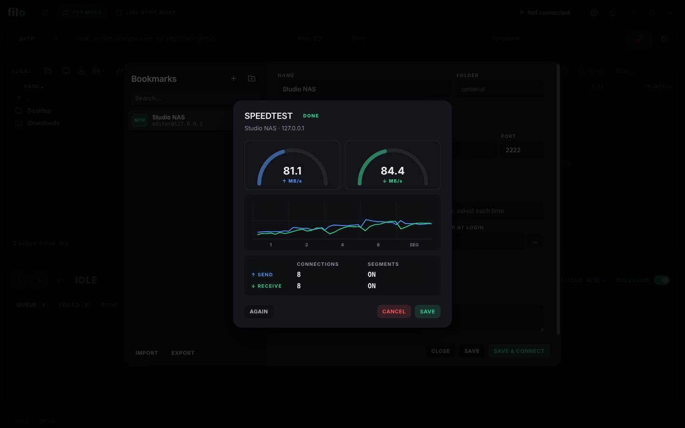
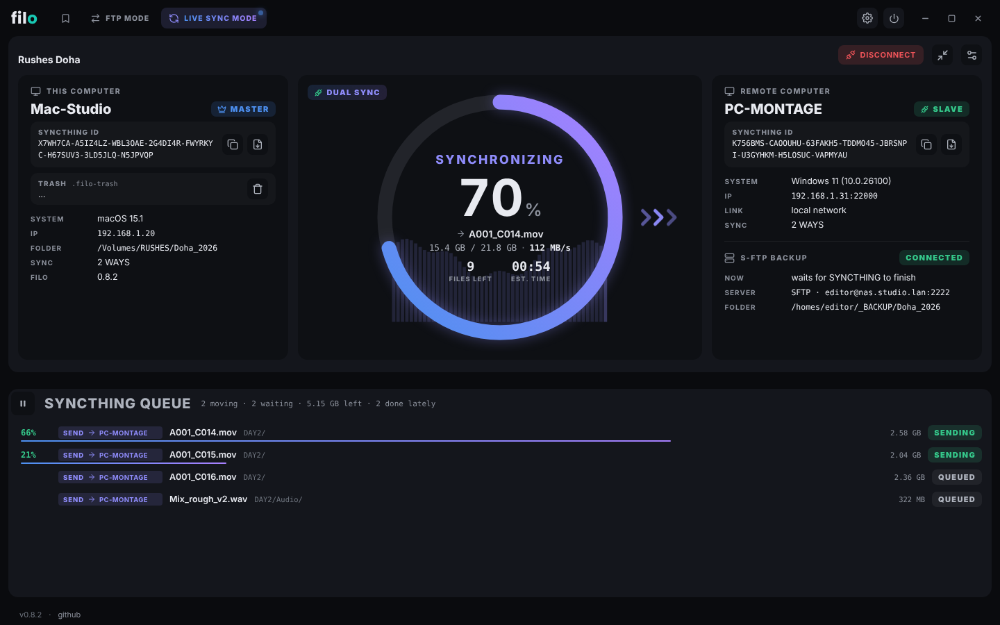
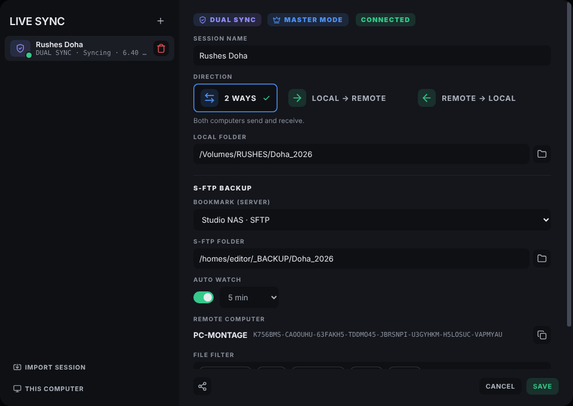

# filo
### FTP, FTPS and SFTP client — by Just Edit

A two-panel file transfer client for video professionals, built for one thing:
moving large files to and from servers as fast as the line allows, and knowing
they arrived intact.

**macOS · Windows · Linux** (AppImage and `.deb`).

Licensed under the **GNU General Public License v3.0** (see [`LICENSE`](./LICENSE)).

---

## Screenshots



| Bookmarks | Settings |
|---|---|
|  |  |

| Speed test of a bookmark |
|---|
|  |

### LIVE SYNC



| A LIVE SYNC session |
|---|
|  |

---

## What it does

| | |
|---|---|
| **Protocols** | SFTP, FTPS (explicit and implicit), plain FTP (flagged as not encrypted). FTP passive or active |
| **Two panels** | local and server side by side; drag and drop between them, or from the Finder / Explorer; synchronized browsing; favorite folders per server (the star); Desktop, Downloads and the mounted disks one click away on the local side; Space shows a local file in Quick Look (Mac) |
| **Queue** | parallel transfers, saved continuously: a crash or a power cut loses nothing. Pause, resume, stop or retry one file or the whole queue; start it at a time of the day (right-click START) |
| **Auto** | measures how many simultaneous transfers are fastest for each server (MB/s and files/s), and stays under a limit the server enforces |
| **Segments** | a large file goes over several SFTP connections at once — the way past the per-connection limit on long-distance links |
| **Rust engine** | over SFTP, the bytes go straight between the disk and the network through a small program written in Rust (`engine/`), outside Node: in a speed test with a Synology DS920+, a 20 GB file came in in 1'41" on 4 connections (FileZilla: 2'40"). filo falls back to its built-in engine when that program is missing or refused |
| **Resume** | a cut transfer starts again where it stopped; a segmented file keeps its finished segments |
| **Checksums** | every file verified after its transfer — by the server (SHA-256, MD5…) when it can compute one, otherwise by reading the file back (xxHash64). On or off from the main window. A delivery already on both sides can be checked again without transferring anything (right-click → Check against the other side) |
| **Safe names** | written as `name.filopart`, renamed only once complete and verified |
| **File already there** | ask, overwrite, overwrite if newer, if the size differs, resume, keep both, skip |
| **Bookmarks** | your servers in folders (a tree that folds), notes, per-site connection limit; import and export, including FileZilla's `sitemanager.xml` |
| **Speed test** | the gauge icon on a bookmark measures the server sending and receiving, with 1, 2, 4 and 8 connections (and segments in SFTP), then suggests the starting settings. Saved with the date and the network: Auto starts from them on that network, and a faster real transfer improves them. Temporary files are removed at the end |
| **Connection** | each step of a connection (address, connection, secure handshake, login, folder) is shown with a clock and a CANCEL that really cuts it; a slow server is said to be slow |
| **Passwords** | in the system keychain (Keychain, Windows Credential Manager, libsecret) — never in clear |
| **Server identity** | SSH host keys and FTPS certificates are shown on first contact and pinned; a change is refused |
| **When it finishes** | phone notification (ntfy), your own command or script (with the folders, the result, the counts as arguments; no shell), then quit, sleep or shut down — only if nothing failed |
| **Speed limits** | per direction, for all transfers together |
| **LIVE SYNC** | a local folder kept in step with another place, one way or both ways, in three kinds of session: **SYNCTHING** (another computer running filo, peer to peer, no server), **DUAL SYNC** (SYNCTHING first; once both computers are up to date, the MASTER keeps a folder on a server, S-FTP BACKUP, in step with both of them: what is put there by hand reaches both computers, and it carries the files while the other computer is away), **S-FTP** (a folder on an FTP, FTPS or SFTP server). While a session is connected, the main window shows both machines side by side and the session's mode (SYNCTHING blue, DUAL SYNC, S-FTP violet) with its connected state, and a ring with the progress, the file moving now, the speed and arrows showing which way files move. The SYNCTHING queue can be paused. A phone alert (ntfy) can say when a session has been down for a while. A clear DISCONNECT button; the ring alone in a small window, and filo in the menu bar / notification area. Every session is also a bookmark in SITES (LIVE SYNC folder). With an S-FTP session, a local file the sync replaces goes to `.filo-trash` first. |
| **SYNCTHING** | peer to peer through the internet boxes (or a relay when no direct path exists), encrypted end to end. The computer that creates a session is its MASTER: its version wins a conflict (the other one is kept beside it), its direction and settings are the session's. It sends the other computer a config file, or the session's SESSION ID; the other computer imports it (right-click LIVE SYNC in the side bar → Import session as SLAVE → PASTE or IMPORT CONFIG), chooses its folder while the MASTER accepts it, and becomes the SLAVE. A deleted file goes to the other computer's trash (`.filo-trash`), never lost. Uses [Syncthing](https://syncthing.net), shipped with filo |
| **S-FTP sessions** | watch the folder, wait until a file is complete, report conflicts; a session can be shared with another team as a small file (no password inside) |
| **Segment relay** | between two filo on one SFTP server: the other team starts downloading a large file while it is still being sent, segment by segment |
| **Command line** | `filo upload / download / livesync / queue / status`, for scripts and other programs — see [`docs/CLI.md`](docs/CLI.md) |

---

## Download

Ready-made builds are on the **[Releases](https://github.com/noar-justedit/filo/releases/latest)** page:

| System | File | Notes |
|---|---|---|
| macOS (Apple Silicon) | `filo-<version>-mac-arm64.dmg` | signed and notarized |
| Windows x64 | `filo-Setup-<version>.exe` or `filo-<version>-win-x64.zip` | not signed: SmartScreen asks once (*More info → Run anyway*) |
| Linux x64 (Ubuntu, Debian, Pop!_OS, Mint…) | `filo_<version>_amd64.deb` | recommended on Linux |
| Linux x64 (any distribution) | `filo-<version>-linux-x86_64.AppImage` | no installation |

filo tells you when a newer version is out (it reads `version.json` from this
repository); it never updates itself.

### Linux

- **`.deb`**: `sudo apt install ./filo_<version>_amd64.deb`. filo appears in the
  applications menu (Network). Remove it with `sudo apt remove filo`.
- **AppImage**: `chmod +x filo-*.AppImage && ./filo-*.AppImage`. It needs FUSE 2:
  `sudo apt install libfuse2t64` (`libfuse2` on Ubuntu 22.04 and older).
- **Ubuntu 24.04 and later**: AppArmor limits the sandbox Electron apps run in.
  The `.deb` installs a profile for filo and just works; an AppImage cannot,
  and on some machines it does not open. Prefer the `.deb` there.
- **Passwords need a desktop keyring** (GNOME Keyring or KWallet, present on
  every usual desktop). Without one, filo does not write a password down: it
  asks for it at each connection.
- "Shut down" and "Sleep" at the end of the queue use `systemctl`, as the
  desktop's own menu does.

---

## Quick install (no coding knowledge required)

1. Install **Node.js** from https://nodejs.org (the **LTS** button).
   For the Rust engine (strongly recommended), install **Rust** too:
   https://rustup.rs (or double-click `scripts/bench-engine.command` once: it
   offers to install it). Without Rust the app is built anyway, with the
   built-in engine, and the build says so.
2. Download filo: **Code → Download ZIP**, unzip it.
3. Double-click **`build_mac.command`**. The first run takes a few minutes.
   When it is done, open the `.dmg` in `dist/` and drag filo into Applications.

For Windows, double-click **`build_windows.command`** — it builds from your Mac.
For the Rust engine of the Windows build, the Mac also needs the MinGW
compiler once: `brew install mingw-w64` (the Windows target of Rust is added
by the build itself).
The portable `.zip` needs nothing more; the `.exe` installer needs Wine once
(`brew install --cask wine-stable`). The Windows build is not signed:
SmartScreen warns on first launch (*More info → Run anyway*).

On a Windows PC, double-click **`build_on_windows.bat`** instead: it builds the
installer and the portable `.zip` there, with no Wine. Node.js (LTS) is the only
thing to install first (and Rust, https://rustup.rs, for the Rust engine). If the build stops on a "symbolic link" / "privilege"
error, turn on Developer Mode (Settings → System → For developers).

### Linux

Build Linux **on Linux** (Ubuntu, Debian, Pop!_OS…): in the folder, run

```bash
./build_linux.sh
```

as your own user, never with `sudo`. It checks Node.js (20.19 or newer; the
`apt` one is too old, and the script says how to get a current one) and the
packaging tools (`sudo apt install dpkg fakeroot`), builds the Rust engine
when Rust is installed (https://rustup.rs), then writes
`dist/filo-<version>-linux-x86_64.AppImage` and `dist/filo_<version>_amd64.deb`.
electron-builder can make an AppImage from a Mac, but the `.deb` it makes there
is not valid, so the Linux packages come from a Linux machine. On Linux,
`./build.sh` does the same.

### Signing (macOS)

With a *Developer ID Application* certificate in your keychain, the Mac build
signs, notarizes and staples on its own. The first signed build asks once for
your Apple ID and an app-specific password (or reuses the ones syncto stored),
and keeps them in the keychain. `FILO_SKIP_SIGN=1 ./build.sh` builds unsigned.

---

## Development

```bash
npm install          # dependencies, once
npm run dev          # run without building (uses your real profile)
npm test             # engine test suite (~3 min, a real SFTP server in-process)
cargo build --release --manifest-path engine/Cargo.toml
                     # the Rust engine: npm run dev and npm test use it once built
FILO_ENGINE=0 npm test   # the same tests on the built-in engine alone
node scripts/syncthing-fetch.js
                     # Syncthing for SYNCTHING, for npm run dev and npm test
                     # (downloaded once, SHA-256 checked; builds do it themselves)
```

How the Rust engine is built into the apps: `scripts/engine-build.js`, run by
electron-builder before each platform is packed (`beforePack`), whichever build
script started it. The same step puts Syncthing (mode SYNCTHING) next to the app
(`scripts/syncthing-fetch.js`): the build needs internet once to download it;
without it, the app is built without SYNCTHING.

Real FTP / FTPS servers can be added to the tests with environment variables
(see `test/run-tests.js`).

## Publishing

Unzip the release ZIP, then double-click `scripts/push_github.command` (macOS)
or `scripts/push_github.bat` (Windows, needs Git for Windows) in the folder:
GitHub becomes exactly that folder. See `AGENTS.md`, rule 7. Then
create the Release for the tag `v<version>` and attach the builds; the text for
it is in `docs/RELEASE-<version>.md`. Run `push_github.command` once more
afterwards: it sends `version.json` last, so nobody is told about an update
before its files can be downloaded.

Contributions: see [`CONTRIBUTING.md`](./CONTRIBUTING.md). Security problems:
see [`SECURITY.md`](./SECURITY.md).

---

## Credits

filo shares its engine conventions, interface language and build scripts with
**syncto** by the same author. It uses [ssh2](https://github.com/mscdex/ssh2)
(MIT), [basic-ftp](https://github.com/patrickjuchli/basic-ftp) (MIT),
[hash-wasm](https://github.com/Daninet/hash-wasm) (MIT),
[Lucide](https://lucide.dev) icons (ISC) and Poppins (OFL). Its Rust transfer
engine is built on [russh](https://github.com/warp-tech/russh) (Apache-2.0)
and [tokio](https://tokio.rs) (MIT).

Every component shipped in a build, with its licence and licence text, is
listed in [`THIRD_PARTY_NOTICES.md`](./THIRD_PARTY_NOTICES.md); the same file
is placed next to the application in each build. All of these licences are
compatible with filo's GPL v3. After a dependency changes, regenerate it with
`node scripts/third-party-notices.js` (needs `npm install` and Rust).
